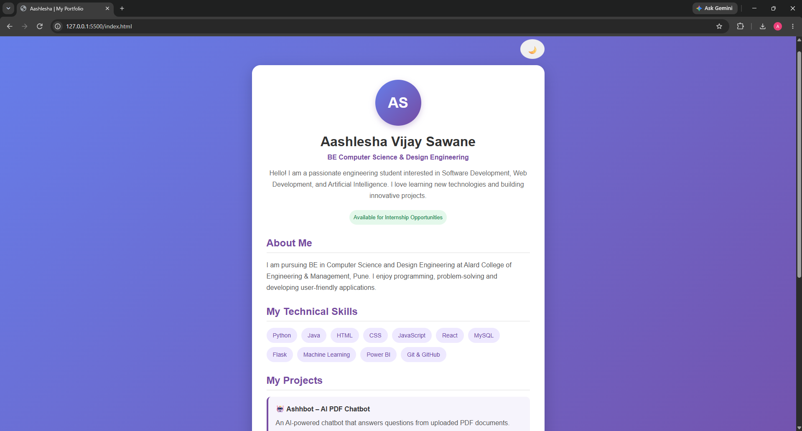
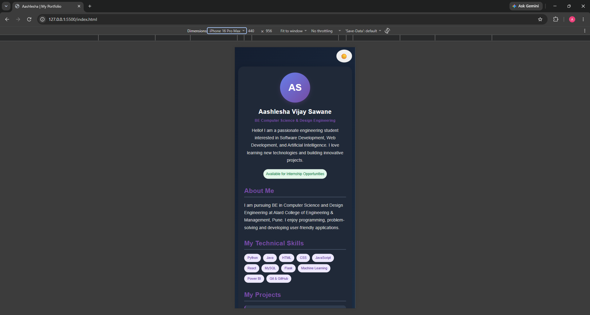
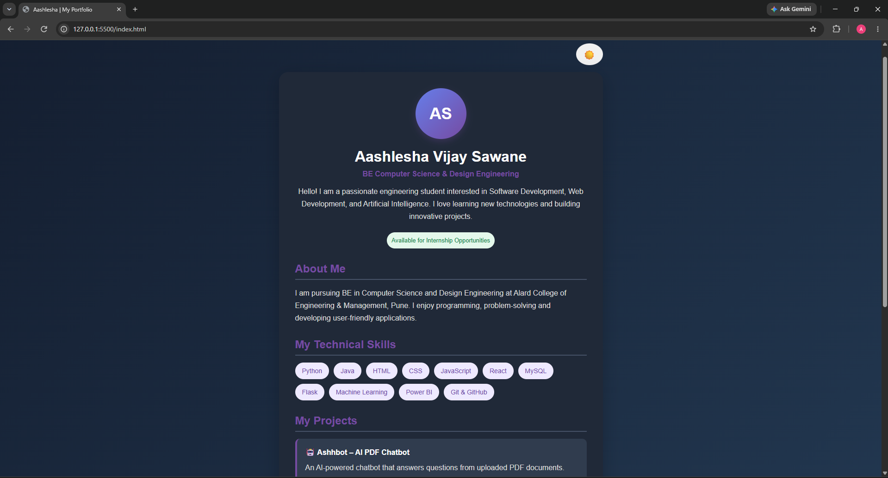

# Personal Portfolio Card

## About the Project
A responsive personal portfolio card developed
using HTML, CSS, and JavaScript.

## Features
- Personal introduction
- Technical skills
- Featured projects
- Contact information
- Responsive mobile-friendly design
- Dark and light mode

## Technologies Used
- HTML5
- CSS3
- JavaScript

## Project Screenshots

### Desktop View

### Mobile Responsive View

### Dark Mode

## Developer
Aashlesha Vijay Sawane

BE Computer Science & Design Engineering

## GitHub
https://github.com/aashleshagit
